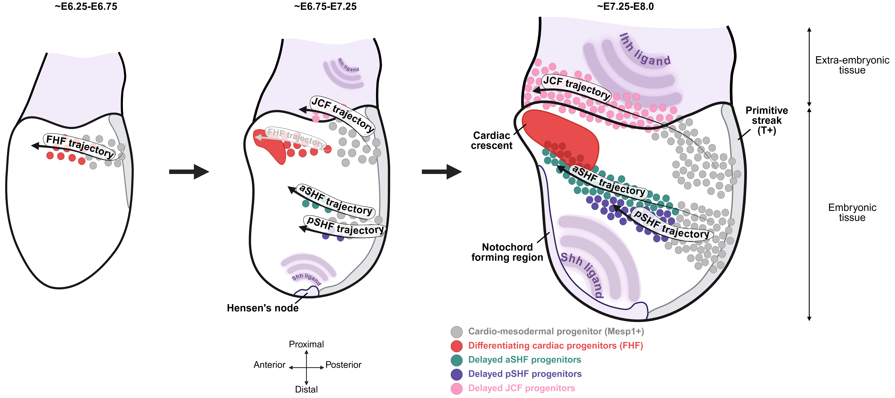

# Hedgehog-associated heterochrony and cardiac progenitor fields' establishment

This repo is associated with the analysis of the impact of Hedgehog signaling in the early heart fields establishment.

1. Single-cell RNA-seq atlas refined for the cardio-mesodermal lineage
2. Hedgehog perturbation scRNA-seq experiment (Mesp1 lineage specific; Gli3T overexpression)

### Abstract

